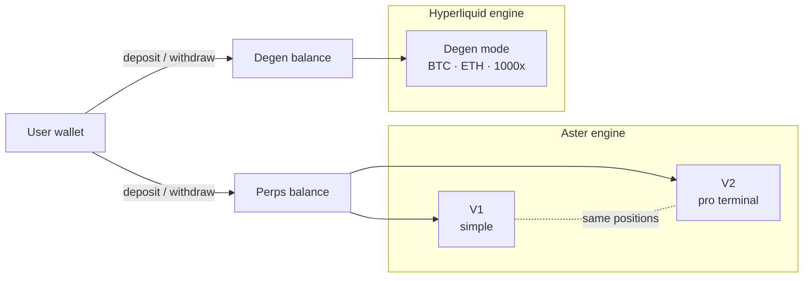

  

# DYXY Perps

How DYXY perpetual futures work: two interfaces on the Aster engine with up to 100x leverage, and Degen mode on Hyperliquid with up to 1000x on BTC and ETH.

> This repository describes how the product works. It does not contain DYXY source code. User guide: [docs.dyxy.io/trade/perps](https://docs.dyxy.io/trade/perps/overview).

## Modes at a glance

| | V1 | V2 | Degen mode |
| --- | --- | --- | --- |
| Interface | Simplified | Professional terminal | Simplified, inside V1 |
| Engine | Aster | Aster | Hyperliquid (HyperEVM) |
| Markets | All listed | All listed | BTC and ETH |
| Max leverage | 100x | 100x | 1000x |
| Orders | Market, TP/SL | Market, limit, stop market, stop limit, TP/SL | Market, TP/SL |
| Order options | — | GTC, IOC, reduce only | — |
| Balance | Perps balance | Perps balance | Degen balance |

V1 and V2 are two views of the same account: same balance, same positions, switchable at any time. Degen mode runs on a separate engine with its own balance and positions.

## Documents

| Document | Contents |
| --- | --- |
| [V1 and V2](docs/v1-and-v2.md) | Interfaces, order types, order options, position controls |
| [Degen mode](docs/degen-mode.md) | 1000x on BTC and ETH, separate balance, liquidation distances |
| [Margin and leverage](docs/margin-and-leverage.md) | Position size, initial and maintenance margin, tiers, cross and isolated |
| [Liquidations](docs/liquidations.md) | Mark price, trigger, process, insurance fund |
| [Funding](docs/funding.md) | How funding keeps perps close to spot |

## Core formulas

| Quantity | Formula |
| --- | --- |
| Position size (notional) | margin × leverage |
| Initial margin | notional ÷ leverage |
| Unrealized PnL, long | size × (mark price − entry price) |
| Unrealized PnL, short | size × (entry price − mark price) |
| Margin balance | collateral + realized PnL + unrealized PnL |
| Margin ratio | maintenance margin ÷ margin balance |
| Funding payment | notional × funding rate |

## Fees

A DYXY trading fee is charged on notional size when a position is opened and when it is closed. Funding flows between traders and is not a DYXY fee. Users with a referral code pay 10% less.

## License

Text and diagrams in this repository are licensed under [CC BY 4.0](LICENSE). The DYXY name and logo are not covered by this license.
