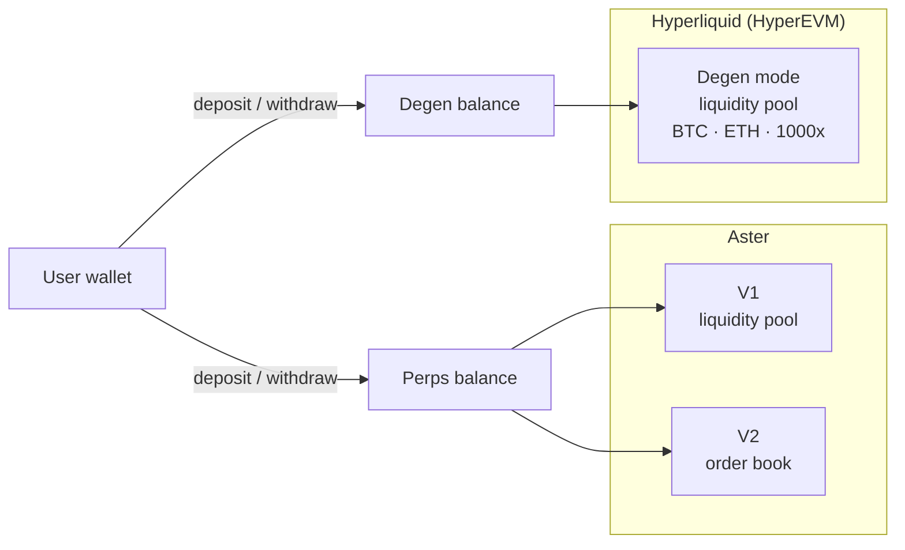

  

# DYXY Perps

How DYXY perpetual futures work: two execution engines on Aster, a liquidity pool (V1) and an order book (V2), both with up to 100x leverage, plus Degen mode, a liquidity pool on Hyperliquid with up to 1000x on BTC and ETH.

> This repository describes how the product works. It does not contain DYXY source code. User guide: [docs.dyxy.io/trade/perps](https://docs.dyxy.io/trade/perps/overview).

## Execution models

V1, V2 and Degen mode differ in **how a trade is executed**:

| | Liquidity pool (V1, Degen mode) | Order book (V2) |
| --- | --- | --- |
| Counterparty | A liquidity pool | Other traders |
| Execution price | Oracle price of the asset | Best matched price in the book |
| Depends on book depth | No | Yes |
| Price for PnL and liquidation | Oracle price | Mark price |

## Modes at a glance

| | V1 | V2 | Degen mode |
| --- | --- | --- | --- |
| Execution | Liquidity pool | Order book | Liquidity pool |
| Engine | Aster | Aster | Hyperliquid (HyperEVM) |
| Markets | All listed | All listed | BTC and ETH |
| Max leverage | 100x | 100x | 1000x |
| Orders | Market, TP/SL | Market, limit, stop market, stop limit, TP/SL | Market, TP/SL |
| Order options | — | GTC, IOC, reduce only | — |
| Margin modes | Per position | Cross or isolated | Per position |
| Balance | Perps balance | Perps balance | Degen balance |

Funds are deposited once into a balance. Every order after that executes from the balance, with no wallet confirmation per trade.

## Documents

| Document | Contents |
| --- | --- |
| [V1: liquidity pool](docs/v1-liquidity-pool.md) | Pool-based execution, oracle pricing, opening and managing positions |
| [V2: order book](docs/v2-order-book.md) | Order matching, order types, order options, margin modes |
| [Degen mode](docs/degen-mode.md) | Pool-based 1000x on BTC and ETH, separate balance, liquidation distances |
| [Margin and leverage](docs/margin-and-leverage.md) | Position size, initial and maintenance margin |
| [Liquidations](docs/liquidations.md) | Trigger price and process for each execution model |
| [Funding](docs/funding.md) | Funding on the order book, holding costs on pools |

## Core formulas

| Quantity | Formula |
| --- | --- |
| Position size (notional) | margin × leverage |
| Initial margin | notional ÷ leverage |
| Unrealized PnL, long | size × (current price − entry price) |
| Unrealized PnL, short | size × (entry price − current price) |
| Margin balance | collateral + unrealized PnL |
| Approximate move to liquidation | 1 ÷ leverage |

## Fees

A DYXY trading fee is charged on notional size when a position is opened and when it is closed. Users with a referral code pay 10% less.

## License

Text and diagrams in this repository are licensed under [CC BY 4.0](LICENSE). The DYXY name and logo are not covered by this license.
