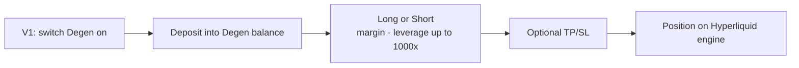

# Degen mode

Degen mode is a toggle inside V1. Switching it on moves BTC and ETH trading from the Aster engine to a dedicated engine on Hyperliquid (HyperEVM), with leverage up to **1000x**.

| | V1 and V2 | Degen mode |
| --- | --- | --- |
| Engine | Aster | Hyperliquid (HyperEVM) |
| Markets | All listed | BTC, ETH |
| Max leverage | 100x | 1000x |
| Balance | Perps balance | Degen balance |
| Positions | Shared between V1 and V2 | Separate |
| Interface | V1 and V2 | V1 only |

## Flow



Switching the toggle off returns the interface to standard trading. Degen positions stay open on their engine until closed.

## Distance to liquidation

Approximate adverse move that consumes the whole margin, ignoring fees and maintenance margin. Real liquidation happens slightly earlier.

```
adverse move ≈ 1 ÷ leverage
```

| Leverage | Adverse move |
| --- | --- |
| 10x | ~10% |
| 50x | ~2% |
| 100x | ~1% |
| 250x | ~0.4% |
| 500x | ~0.2% |
| 1000x | ~0.1% |

## Fees at high leverage

The trading fee is charged on the full notional size. At 1000x, notional is 1000 times the margin, so opening and closing fees are large relative to the margin and the price must move further in the trader's favor just to break even.
