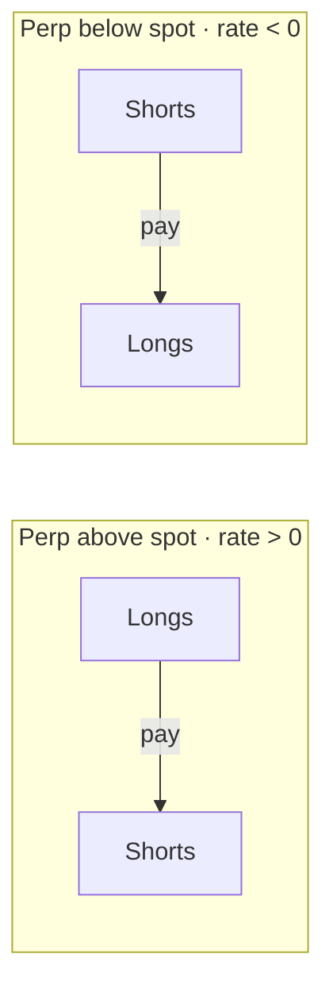

# Funding

Perpetual futures have no expiry, so a periodic **funding payment** between longs and shorts keeps the perp price close to the spot price.



```
funding payment = notional × funding rate
```

**Example.** A $10,000 ETH long with a +0.01% rate pays $1 at the funding time. A $10,000 short receives $1.

- Funding is exchanged between traders. DYXY receives no part of it.
- Only positions open at the funding time pay or receive.
- The current rate, the interval and a countdown to the next payment are shown in the market bar. Past payments appear in funding history.

| Situation | Effect |
| --- | --- |
| Long while funding is strongly positive | Pays at every interval |
| Short while funding is strongly positive | Collects on top of any price gain |
| Holding for weeks | Funding can exceed trading fees |
| In and out within an hour | Usually negligible |
