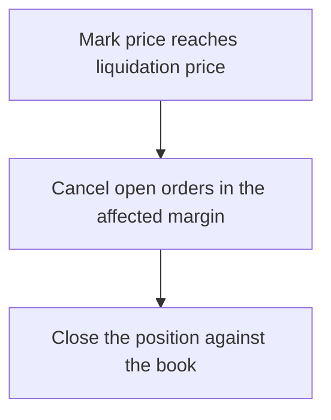

# Liquidations

A position is liquidated when its losses use up its margin down to the maintenance level. The trigger price depends on the execution model.

| | V1 and Degen mode (liquidity pool) | V2 (order book) |
| --- | --- | --- |
| Trigger | Oracle price reaches the liquidation price | Mark price reaches the liquidation price |
| Process | Position closed at that price, remaining margin lost | Open orders cancelled, position closed against the book |

## Mark price (V2)

The mark price is built from prices on several major exchanges. It drives unrealized PnL and liquidations on the order book, so a single unusual trade or a thin moment in the book cannot liquidate a position on its own.

## Order book process (V2)



## Cross and isolated (V2)

- **Isolated:** only the margin assigned to that position can be lost.
- **Cross:** all cross positions share one margin balance, so a large loss in one lowers the buffer of all.

## Avoiding liquidation

| Action | Effect |
| --- | --- |
| Lower leverage | Liquidation price further from entry |
| Stop loss | Exit on the trader's terms before liquidation |
| Add margin (isolated, V2) | Moves the liquidation price away |
| Reduce size | Lowers the maintenance margin required |

## Distance to liquidation

```
adverse move ≈ 1 ÷ leverage
```

At 100x about 1%, at 1000x in Degen mode about 0.1%.
