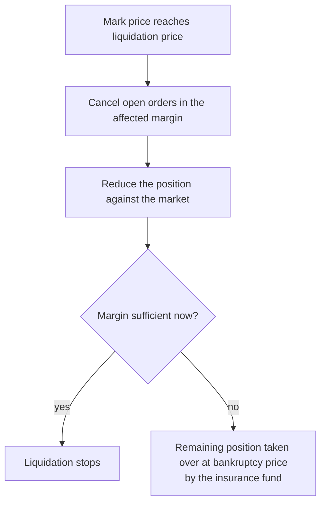

# Liquidations

A position is liquidated when its margin balance falls below the maintenance margin, which happens when the **mark price** reaches the **liquidation price**.

## Mark price

The mark price is built from prices on several major spot exchanges and funding data. It drives unrealized PnL and liquidations, so a single unusual trade or a thin moment in the order book cannot liquidate a position on its own. The last traded price is used for realized PnL.

## Process

A liquidation fee applies. Part of it funds the insurance fund, which absorbs losses from positions closed below their bankruptcy price.

## Cross and isolated

- **Isolated:** only the margin assigned to that position can be lost.
- **Cross:** all cross positions share one margin balance, so a large loss in one lowers the buffer of all.

## Avoiding liquidation

| Action | Effect |
| --- | --- |
| Lower leverage | Liquidation price further from entry |
| Stop loss | Exit on the trader's terms before liquidation |
| Add margin (isolated) | Moves the liquidation price away |
| Reduce size | Lowers the maintenance margin required |

## Degen mode

Degen mode follows the same principle on its own engine. At up to 1000x leverage, liquidation can follow a move of a fraction of a percent.
