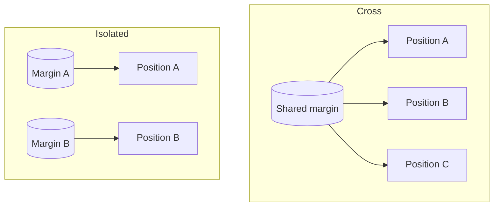

# Margin and leverage

## Position size

```
notional = margin × leverage
```

| Margin | Leverage | Notional | PnL on a 1% move |
| --- | --- | --- | --- |
| $1,000 | 2x | $2,000 | $20 |
| $1,000 | 10x | $10,000 | $100 |
| $1,000 | 50x | $50,000 | $500 |
| $1,000 | 100x | $100,000 | $1,000 |

## Initial margin

```
initial margin = notional ÷ leverage
```

A $20,000 ETH position at 20x needs $1,000 of initial margin.

## Maintenance margin and tiers

Maintenance margin is the minimum margin required to keep a position open. Its rate depends on **position size**, not on the selected leverage.

| Position size | Max leverage | Maintenance rate |
| --- | --- | --- |
| Smallest tier | Highest, up to 100x | Lowest |
| Middle tiers | Lower | Higher |
| Largest tier | Lowest | Highest |

Exact tiers per market are shown in the order panel.

## Margin ratio

```
margin balance = collateral + realized PnL + unrealized PnL
margin ratio   = maintenance margin ÷ margin balance
```

Liquidation starts when the margin ratio reaches 100%. Keeping it below 80% leaves room for volatility.

## Cross and isolated



Cross is the default. Isolated margin can be topped up manually to move the liquidation price away.

## Choosing leverage from the stop

```
max sensible leverage ≈ 1 ÷ stop distance
```

With a stop 3% away, leverage above about 25–30x risks liquidation before the stop is hit. Lower leverage is always safer.
