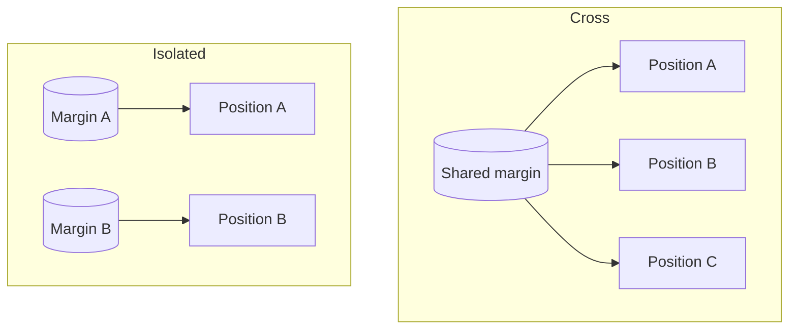

# Margin and leverage

## Position size

```
notional = margin × leverage
```

| Margin | Leverage | Notional | PnL on a 1% move |
| --- | --- | --- | --- |
| $1,000 | 2x | $2,000 | $20 |
| $1,000 | 10x | $10,000 | $100 |
| $1,000 | 50x | $50,000 | $500 |
| $1,000 | 100x | $100,000 | $1,000 |

## Initial margin

```
initial margin = notional ÷ leverage
```

A $20,000 ETH position at 20x needs $1,000 of initial margin.

## Maintenance margin

Maintenance margin is the minimum margin required to keep a position open. Larger positions can require a higher rate and allow lower maximum leverage. Exact limits per market are shown in the order panel.

## Cross and isolated (V2)



Cross and isolated margin are available on the order book (V2). Isolated margin can be topped up manually to move the liquidation price away. In V1 and Degen mode each position is backed by its own margin.

## Choosing leverage from the stop

```
max sensible leverage ≈ 1 ÷ stop distance
```

With a stop 3% away, leverage above about 25–30x risks liquidation before the stop is hit. Lower leverage is always safer.
