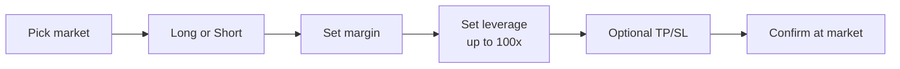
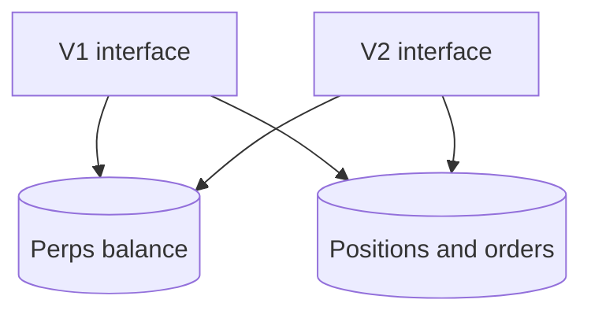

# V1 and V2

Both interfaces run on the Aster engine with up to 100x leverage on every listed market, and share one perps balance and one set of positions.

## V1: simple

Built for fast market trades with clear risk figures.

Before confirmation V1 shows position size, entry price, liquidation price, trading fee and the current funding rate. Open positions can be closed fully or partially, and TP/SL can be added or edited.

V1 also contains the **Degen mode** toggle. See [Degen mode](degen-mode.md).

## V2: pro

A full terminal: chart with plotted entry, liquidation and TP/SL levels, live order book, recent trades, order panel and account panel with positions, open orders and histories.

### Order types

| Order | Behavior |
| --- | --- |
| Market | Fills immediately at the best price in the book |
| Limit | Rests in the book, fills at the limit price or better |
| Stop market | Sends a market order when the mark price reaches the trigger |
| Stop limit | Places a limit order when the mark price reaches the trigger |
| Take profit / Stop loss | Closes the position at the target or stop. Attach on open or add later |

### Order options

| Option | Behavior |
| --- | --- |
| GTC | Good till cancelled. The order stays in the book until filled or cancelled |
| IOC | Immediate or cancel. Fills what it can right away, cancels the rest |
| Reduce only | Can only reduce an existing position, never open or increase one |

### Margin modes

| | Cross | Isolated |
| --- | --- | --- |
| Margin | Whole available balance backs all cross positions | Only the margin assigned to the position |
| Risk | Losses can draw on the whole balance | Losses limited to the position's margin |
| Liquidation | Shared risk level | Separate liquidation price per position |

The margin mode is set per market and cannot change while there is an open position or open order in that market.

### Position controls

- Close at market or with a limit order
- Partial close
- Add or remove margin on isolated positions
- Set or adjust TP/SL

## Shared account

A position opened in V1 is visible and manageable in V2, and the other way around.
