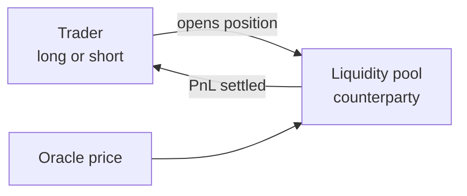
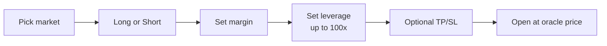

# V1: liquidity pool

In V1, traders don't trade with each other. Every position is opened against a **liquidity pool** on the Hyperliquid engine (HyperEVM), which takes the other side. Entries and exits happen at the **oracle price**, an index price built from major exchanges.

| Property | Behavior |
| --- | --- |
| Counterparty | Liquidity pool |
| Price | Oracle price at the moment of the trade |
| Order book | None |
| Markets | All listed markets |
| Max leverage | 100x |
| Orders | Market, with optional TP/SL |
| Balance | Perps balance, shared with V2 |

## Flow

Before opening, the panel shows position size, entry price, liquidation price and the trading fee. Open positions can be closed fully or partially, and TP/SL can be added or edited.

## Profit and loss

The pool is the counterparty to every position. A trader's profit is paid from the pool, and a trader's loss goes to the pool.

V1 also contains the **Degen mode** toggle. See [Degen mode](degen-mode.md).
