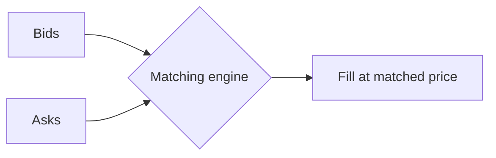

# V2: order book

In V2, orders go into an **order book** on the Aster engine. Buy orders (bids) and sell orders (asks) from all traders meet in the book, and a trade happens when they match. The counterparty is another trader.

| Property | Behavior |
| --- | --- |
| Counterparty | Other traders |
| Price | Matched in the book. Market orders can fill across several levels |
| PnL and liquidation price | Mark price, built from several major exchanges |
| Markets | All listed markets |
| Max leverage | 100x |
| Balance | Perps balance, shared with V1 |

## Order types

| Order | Behavior |
| --- | --- |
| Market | Fills immediately at the best prices in the book |
| Limit | Rests in the book, fills at the limit price or better |
| Stop market | Sends a market order when the price reaches the trigger |
| Stop limit | Places a limit order when the price reaches the trigger |
| Take profit / Stop loss | Closes the position at the target or stop. Attach on open or add later |

## Order options

| Option | Behavior |
| --- | --- |
| GTC | Good till cancelled. Stays in the book until filled or cancelled |
| IOC | Immediate or cancel. Fills what it can right away, cancels the rest |
| Reduce only | Can only reduce an existing position, never open or increase one |

## Margin modes

| | Cross | Isolated |
| --- | --- | --- |
| Margin | Available balance backs all cross positions | Only the margin assigned to the position |
| Risk | Losses can draw on the whole balance | Losses limited to the position's margin |
| Liquidation | Shared risk level | Separate liquidation price per position |

The margin mode is set per market and cannot change while there is an open position or open order in that market.
